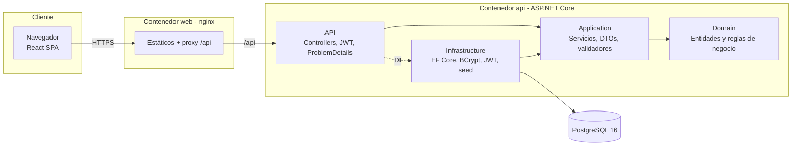

# Sistema de Punto de Venta (POS)

Sistema full-stack de punto de venta para un comercio minorista peruano: catálogo de productos, clientes, **apertura y cierre de caja con arqueo**, ventas con **múltiples medios de pago (efectivo, tarjeta, Yape, Plin)**, **boletas y facturas con serie-correlativo e IGV 18 %**, anulación con reposición de stock y reportes por día, producto y cajero.

Construido con **ASP.NET Core (.NET 10) + EF Core + PostgreSQL** en el backend y **React 18 + Vite + TypeScript + Tailwind CSS** en el frontend, siguiendo una arquitectura en capas limpia, con pruebas automatizadas y despliegue con Docker.

> Proyecto de portafolio. Todos los datos de ejemplo (empresas, RUC, DNI, personas) son **ficticios**.

---

## Tabla de contenidos

- [Capturas](#capturas)
- [Características](#características)
- [Arquitectura](#arquitectura)
- [Stack y justificación](#stack-y-justificación)
- [Inicio rápido con Docker](#inicio-rápido-con-docker)
- [Ejecución sin Docker](#ejecución-sin-docker)
- [Credenciales de demostración](#credenciales-de-demostración)
- [Endpoints principales](#endpoints-principales)
- [Pruebas](#pruebas)
- [Estructura de carpetas](#estructura-de-carpetas)
- [Variables de entorno](#variables-de-entorno)
- [Qué aprenderás con este proyecto](#qué-aprenderás-con-este-proyecto)
- [Roadmap](#roadmap)
- [Licencia y autor](#licencia-y-autor)

---

## Capturas

> Espacio reservado para capturas reales. Sugerencias de qué capturar (guardar en `docs/capturas/`):
>
> 1. **Login** con el recuadro de cuentas demo.
> 2. **Dashboard** con KPIs (ventas de hoy, ticket promedio, ventas del mes, stock bajo) y gráfico de 7 días.
> 3. **Nueva venta**: catálogo a la izquierda, carrito con IGV, pago mixto (Yape + efectivo) y vuelto.
> 4. **Comprobante** emitido (B001-00000027) en el modal de confirmación.
> 5. **Caja**: arqueo al cierre con faltante/sobrante.
> 6. **Reportes** por día en modo oscuro.

---

## Características

**Ventas y comprobantes**
- Boleta (serie `B001`) o factura (serie `F001`) con correlativo de 8 dígitos (`B001-00000123`) **sin huecos ni duplicados**, reservado atómicamente en la base de datos.
- Cálculo de **IGV 18 %** extraído de precios que ya lo incluyen (precio de góndola), con redondeo comercial y garantía de que `op. gravada + IGV = total` al céntimo.
- **Factura solo a clientes con RUC**; boletas mayores a **S/ 700** exigen identificar al cliente (regla SUNAT).
- Validación de **RUC (módulo 11 de SUNAT)** y **DNI (8 dígitos)** en backend y frontend.
- **Pagos múltiples** por venta: efectivo, tarjeta, Yape y Plin. El vuelto solo sale del efectivo; los pagos electrónicos no pueden exceder el total.
- **Descuento** por venta, limitado al 10 % para el cajero (control antifraude); el admin no tiene tope.
- **Descuento de stock transaccional** con `UPDATE ... WHERE stock >= cantidad`: imposible vender la última unidad dos veces; si un ítem falla, se revierte toda la venta.
- **Anulación** (solo admin) con motivo obligatorio: el comprobante se conserva como "Anulada" y el stock se repone.

**Caja**
- Apertura de turno con fondo inicial; un cajero no puede tener dos cajas abiertas.
- No se puede vender sin caja abierta.
- **Cierre con arqueo**: efectivo esperado = fondo + efectivo neto de vuelto de ventas emitidas; se registra el contado y la diferencia (faltante/sobrante). Totales por medio de pago.

**Catálogo y clientes**
- Productos con SKU único, categoría, precio, stock y stock mínimo (alertas de stock bajo), baja lógica y ajustes manuales de inventario.
- Clientes DNI/RUC con búsqueda rápida por documento y registro "al vuelo" desde la pantalla de venta.

**Reportes y dashboard**
- KPIs del día y del mes, ventas de los últimos 7 días, top de productos (el cajero ve solo sus cifras).
- Reportes de ventas por **día**, **producto** y **cajero** con rango de fechas (hora de Lima).

**Transversal**
- JWT con roles **Admin** y **Cajero**, autorización por endpoint y filtrado de datos por propietario.
- Contraseñas con **BCrypt** (factor 12) y política de complejidad; limitador de intentos de login.
- Errores homogéneos en formato **ProblemDetails (RFC 9457)** con `traceId` y código de regla de negocio.
- Logging estructurado con **Serilog** (JSON en producción), `/health` con verificación de base de datos y **Swagger/OpenAPI**.
- Listados con **paginación, búsqueda, filtros y ordenamiento** (lista blanca de columnas).
- Frontend responsive con **modo oscuro**, estados de carga/vacío/error y validación de formularios.

---

## Arquitectura



Las dependencias apuntan **hacia el dominio**: `Domain` no conoce a nadie, `Application` solo conoce al dominio y a interfaces (`IAppDbContext`, `ICurrentUser`, `ITokenService`), e `Infrastructure` implementa esas interfaces. La API compone todo con inyección de dependencias. Más detalle en [docs/arquitectura.md](docs/arquitectura.md).

---

## Stack y justificación

| Capa | Tecnología | Por qué |
|---|---|---|
| Backend | ASP.NET Core Web API (**.NET 10**) | Alto rendimiento, tipado fuerte, DI y middleware nativos. Se usa `net10.0` (SDK/runtime LTS disponible en el entorno de desarrollo). |
| ORM | Entity Framework Core 10 | Migraciones versionadas, LINQ tipado, `ExecuteUpdate` para operaciones atómicas de stock. |
| Base de datos | PostgreSQL 16 | Transacciones ACID robustas, `numeric(12,2)` exacto para dinero, bloqueos a nivel de fila. |
| Validación | FluentValidation | Reglas legibles y testeables, separadas de los DTOs. |
| Seguridad | JWT Bearer + BCrypt | Sesión sin estado apta para varias cajas; hash lento contra fuerza bruta. |
| Logging | Serilog | Logs estructurados (JSON) listos para ELK/Loki. |
| Documentación | Swashbuckle (OpenAPI) | Contrato navegable y probable desde `/swagger`. |
| Pruebas backend | xUnit + WebApplicationFactory + SQLite en memoria | Pruebas de integración reales de la API sin Docker. |
| Frontend | React 18 + Vite + TypeScript | Ecosistema maduro, build rápido, tipos compartidos con los DTOs. |
| Estilos | Tailwind CSS 3 | Diseño consistente y modo oscuro por clase sin CSS ad hoc. |
| Pruebas frontend | Vitest + Testing Library | Mismo pipeline que Vite, pruebas de componentes centradas en el usuario. |
| Despliegue | Docker multi-stage + docker-compose + nginx | Un comando para levantar todo; imágenes pequeñas y sin root. |

---

## Inicio rápido con Docker

Requisitos: Docker Desktop (o Docker Engine + Compose v2).

```bash
cp .env.example .env          # ajuste POSTGRES_PASSWORD y JWT_KEY
docker compose up -d --build
```

| Servicio | URL |
|---|---|
| Aplicación web | http://localhost:8080 |
| API + Swagger | http://localhost:5080/swagger |
| Health check | http://localhost:5080/health |

Al primer arranque la API aplica las migraciones de PostgreSQL y siembra los datos de demostración (usuarios, 15 productos, 5 clientes y una semana de ventas históricas).

---

## Ejecución sin Docker

### Backend

Requisitos: [.NET SDK 10](https://dotnet.microsoft.com/download).

```bash
cd backend
dotnet run --project src/PuntoVenta.Api --launch-profile http
```

En modo `Development` la API usa **SQLite** (archivo `punto_venta_dev.db`) para que no necesites instalar PostgreSQL; el esquema se crea solo y se siembran los datos demo. Queda escuchando en http://localhost:5080 (Swagger en `/swagger`).

¿Quieres usar PostgreSQL local? Sobrescribe la configuración:

```bash
export Database__Provider=Postgres
export ConnectionStrings__Default="Host=localhost;Database=punto_venta;Username=pos;Password=..."
dotnet run --project src/PuntoVenta.Api --launch-profile http   # aplica las migraciones automáticamente
```

Para crear nuevas migraciones: `dotnet tool restore && dotnet ef migrations add Nombre -p src/PuntoVenta.Infrastructure -s src/PuntoVenta.Infrastructure -o Persistence/Migrations`. El script SQL equivalente está en [docs/esquema-postgres.sql](docs/esquema-postgres.sql).

### Frontend

Requisitos: Node.js 20+ (probado con Node 24).

```bash
cd frontend
npm install
npm run dev        # http://localhost:5173 (proxy de /api → http://localhost:5080)
```

---

## Credenciales de demostración

| Rol | Correo | Contraseña |
|---|---|---|
| Administrador | `admin@demo.pe` | `Demo123!` |
| Cajero | `cajero@demo.pe` | `Demo123!` |
| Cajero | `cajero2@demo.pe` | `Demo123!` |

Clientes de prueba: RUC `20601234565` (Bodega El Ejemplo S.A.C.), RUC `20509876542`, DNI `45678912`. **Cambie o desactive estas cuentas en un entorno real** (`SEED_DEMO_DATA=false`).

---

## Endpoints principales

Todos bajo `/api`, con JWT (`Authorization: Bearer <token>`) salvo el login. Ejemplos curl en [docs/guia-api.md](docs/guia-api.md).

| Método | Ruta | Rol | Descripción |
|---|---|---|---|
| POST | `/auth/login` | Público | Obtiene el token JWT |
| GET | `/auth/me` | Autenticado | Usuario actual |
| GET | `/products` | Autenticado | Lista paginada (`search`, `categoryId`, `lowStock`, `sortBy`, `sortDir`) |
| POST / PUT / DELETE | `/products[/{id}]` | Admin | Alta, edición, baja lógica |
| POST | `/products/{id}/stock-adjustments` | Admin | Ajuste manual de stock |
| GET / POST / PUT / DELETE | `/categories` | Lectura: todos · Escritura: Admin | Categorías |
| GET / POST / PUT | `/customers` | Autenticado | Clientes (búsqueda, filtro DNI/RUC) |
| GET | `/customers/by-document/{doc}` | Autenticado | Búsqueda rápida por DNI/RUC |
| POST | `/cash-sessions/open` | Autenticado | Abrir caja |
| GET | `/cash-sessions/current` | Autenticado | Caja abierta del usuario (204 si no hay) |
| POST | `/cash-sessions/{id}/close` | Dueño o Admin | Cierre con arqueo |
| GET | `/cash-sessions` | Autenticado | Historial (cajero: solo los suyos) |
| POST | `/sales` | Autenticado (con caja abierta) | Registrar venta |
| GET | `/sales`, `/sales/{id}` | Autenticado | Ventas (cajero: solo las suyas) |
| POST | `/sales/{id}/void` | Admin | Anular y reponer stock |
| GET | `/reports/dashboard` | Autenticado | KPIs |
| GET | `/reports/sales-by-day` · `sales-by-product` · `sales-by-cashier` | Admin | Reportes con `from`/`to` |
| GET / POST / PUT | `/users`, `/users/{id}/password` | Admin | Gestión de usuarios |
| GET | `/health` | Público | Estado de la API y la base de datos |

Códigos de respuesta: `400` validación (con `errors` por campo), `401` no autenticado, `403` sin permiso, `404` no existe, `409` conflicto (duplicados, caja ya abierta), `422` regla de negocio (con `code`, p. ej. `stock_insuficiente`, `factura_sin_ruc`, `caja_no_abierta`).

---

## Pruebas

```bash
# Backend: 38 unitarias (dominio) + 20 de integración (API real sobre SQLite en memoria). No requiere Docker.
cd backend && dotnet test

# Frontend: 29 pruebas (lógica de venta, cliente API, componentes y login)
cd frontend && npm test

# Calidad
cd frontend && npm run lint && npm run build
cd backend && dotnet format --verify-no-changes
```

Las pruebas de integración levantan la API completa con `WebApplicationFactory`, se autentican con JWT y verifican flujos reales: venta con IGV y correlativo consecutivo, **rollback de la transacción cuando falta stock**, factura sin RUC, límites de descuento y pagos, anulación con reposición, arqueo excluyendo anuladas, aislamiento entre cajeros y reportes.

La CI de GitHub Actions (`.github/workflows/ci.yml`) ejecuta formato, build, pruebas y publish del backend, y lint, pruebas y build del frontend.

---

## Estructura de carpetas

```
sistema-punto-de-venta/
├── backend/
│   ├── PuntoVenta.sln
│   ├── Dockerfile                    # multi-stage, usuario no root
│   ├── dotnet-tools.json             # dotnet-ef fijado para migraciones
│   ├── src/
│   │   ├── PuntoVenta.Domain/        # Entidades (Sale, CashSession, Product…), reglas, IGV, RUC/DNI
│   │   ├── PuntoVenta.Application/   # Servicios de caso de uso, DTOs, validadores, paginación
│   │   ├── PuntoVenta.Infrastructure/# EF Core (DbContext, configuraciones, migraciones), BCrypt, JWT, seed
│   │   └── PuntoVenta.Api/           # Controllers, Program.cs, manejo global de errores
│   └── tests/
│       ├── PuntoVenta.UnitTests/     # Reglas de dominio
│       └── PuntoVenta.IntegrationTests/ # API end-to-end con SQLite en memoria
├── frontend/
│   ├── Dockerfile · nginx.conf       # build + nginx sin privilegios
│   └── src/
│       ├── lib/                      # cliente API, tipos, lógica de venta, formateo, validadores
│       ├── context/ · hooks/         # sesión (JWT), useAsync, tema oscuro
│       ├── components/               # Layout con sidebar, UI base, comprobante
│       └── pages/                    # Login, Dashboard, POS, Ventas, Caja, Productos, Clientes, Reportes, Usuarios
├── docs/
│   ├── arquitectura.md · modelo-datos.md · guia-api.md
│   ├── esquema-postgres.sql          # script idempotente generado desde las migraciones
│   └── decisiones/                   # ADRs
├── docker-compose.yml · .env.example
└── .github/workflows/ci.yml
```

---

## Variables de entorno

| Variable (docker-compose) | Equivalente en .NET | Descripción |
|---|---|---|
| `POSTGRES_DB` / `POSTGRES_USER` / `POSTGRES_PASSWORD` | `ConnectionStrings__Default` | Credenciales de PostgreSQL |
| `JWT_KEY` | `Jwt__Key` | Clave HMAC (≥ 32 caracteres). La API no arranca sin ella |
| `JWT_EXPIRATION_MINUTES` | `Jwt__ExpirationMinutes` | Vigencia del token (por defecto 480 = un turno) |
| `SEED_DEMO_DATA` | `Database__SeedDemoData` | Siembra datos de demostración |
| `SWAGGER_ENABLED` | `Swagger__Enabled` | Publica `/swagger` |
| — | `Database__Provider` | `Postgres` (por defecto) o `Sqlite` |
| — | `Cors__Origins__0` | Orígenes permitidos si el frontend corre en otro dominio |
| — | `RateLimiting__LoginPermitPerMinute` | Intentos de login por IP y minuto (10) |
| `API_PORT` / `WEB_PORT` | — | Puertos publicados en el host |

---

## Qué aprenderás con este proyecto

- Estructurar una solución .NET en **capas (Domain, Application, Infrastructure, API)** y por qué las dependencias apuntan al dominio.
- Modelar un **agregado** (`Sale`) que protege sus invariantes: totales, IGV, vuelto y reglas tributarias.
- Resolver la **concurrencia de stock** sin bloqueos optimistas complicados, con un `UPDATE` condicional atómico.
- Generar **correlativos sin huecos** dentro de una transacción.
- Diseñar respuestas de error consistentes con **ProblemDetails** y un manejador global.
- Implementar **JWT con roles** y además autorización a nivel de datos ("el cajero solo ve lo suyo").
- Escribir **pruebas de integración reales** de una API sin depender de Docker.
- Construir un frontend React con **cliente API tipado**, manejo de sesión expirada, formularios validados y modo oscuro.
- Empaquetar todo con **Docker multi-stage** y una **CI** en GitHub Actions.

---

## Roadmap

- [ ] Emisión electrónica real a SUNAT (XML UBL 2.1 + firma digital vía OSE/PSE).
- [ ] Notas de crédito como alternativa a la anulación después del día de emisión.
- [ ] Impresión térmica (ESC/POS) y PDF del comprobante con código QR.
- [ ] Lector de código de barras y atajos de teclado en la pantalla de venta.
- [ ] Kardex de inventario (historial de movimientos y ajustes con usuario).
- [ ] Multi-tienda / multi-caja física con series por punto de emisión.
- [ ] Refresh tokens y revocación de sesiones.
- [ ] Pruebas E2E con Playwright y pruebas de concurrencia contra PostgreSQL (Testcontainers).

---

## Licencia y autor

Distribuido bajo licencia [MIT](LICENSE).

**Angel Castañeda Meza** — Ingeniero de Sistemas, Lima, Perú
GitHub: [@angel-cm-dev](https://github.com/angel-cm-dev)
