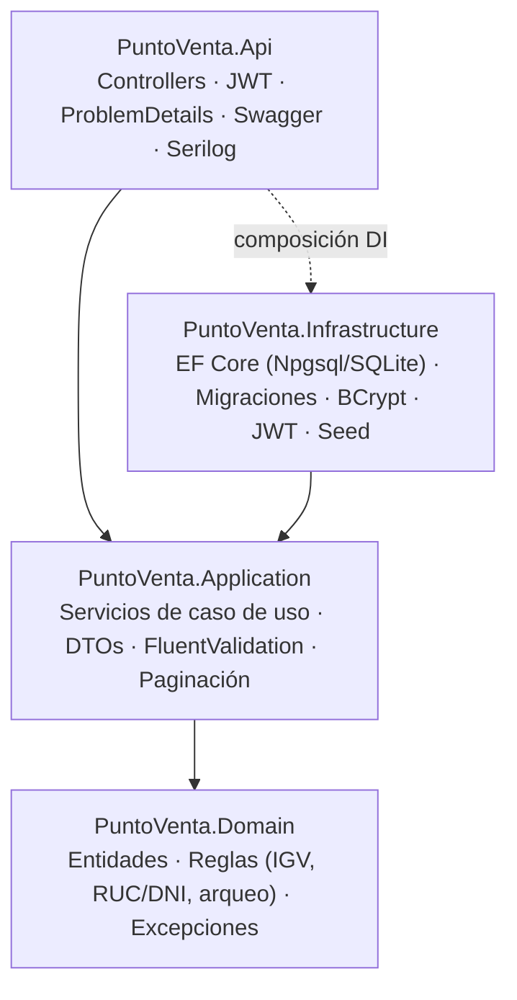
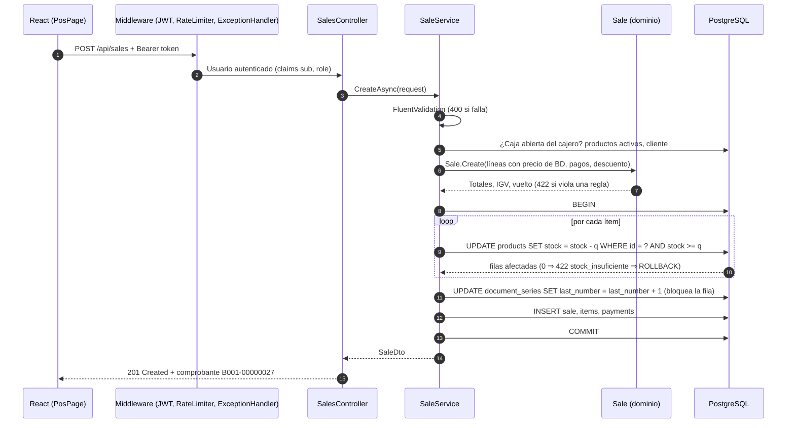

# Arquitectura

## Capas

| Capa | Responsabilidad | Depende de |
|---|---|---|
| **Domain** | Entidades con setters privados y métodos que validan invariantes (`Sale.Create`, `CashSession.Close`, `Product.AdjustStock`). Servicios puros: `TaxCalculator`, `IdentityDocumentValidator`. | Nada |
| **Application** | Casos de uso (`SaleService`, `CashSessionService`, `ReportService`…): orquestan dominio y persistencia, aplican autorización a nivel de datos y validan la entrada. Define los puertos `IAppDbContext`, `ICurrentUser`, `IPasswordHasher`, `ITokenService`. | Domain, abstracciones de EF Core |
| **Infrastructure** | Implementa los puertos: `AppDbContext` con configuraciones Fluent API, migraciones de PostgreSQL, `BCryptPasswordHasher`, `JwtTokenService`, `DataSeeder`. | Application |
| **Api** | HTTP: rutas, autenticación/autorización por rol, rate limiting, manejo global de errores, health checks, OpenAPI. Adaptador `HttpCurrentUser`. | Application, Infrastructure (solo para registrar DI) |

## Flujo de una petición: `POST /api/sales`

Si cualquier paso lanza una excepción, `GlobalExceptionHandler` la traduce a ProblemDetails (`400/403/404/409/422/500`) y, como la transacción nunca llegó al `COMMIT`, el `await using` la revierte.

## Decisiones clave

- **El dominio protege sus invariantes**: no hay forma de construir una `Sale` con totales inconsistentes o una factura sin RUC; las reglas se prueban sin base de datos (38 pruebas unitarias).
- **Precios desde la base de datos**: el cliente HTTP solo envía `productId` y `cantidad`; nunca precios.
- **Stock atómico** (ver [ADR-0001](decisiones/0001-descuento-de-stock-atomico.md)).
- **`IAppDbContext` en lugar de repositorios genéricos** (ver [ADR-0002](decisiones/0002-dbcontext-como-puerto.md)).
- **SQLite para pruebas y desarrollo local** (ver [ADR-0003](decisiones/0003-sqlite-para-pruebas.md)).
- **Fechas en UTC, días en hora de Lima**: los reportes agrupan con desfase fijo UTC−5 (Perú no usa horario de verano).
- **Autorización en dos niveles**: por rol en el endpoint (`[Authorize(Roles = "Admin")]`) y por propietario en el servicio (un cajero solo ve sus ventas y cajas).
- **Errores homogéneos**: todos los errores siguen RFC 9457 e incluyen `traceId` para correlacionar con los logs.

## Seguridad

- Contraseñas con BCrypt (factor 12) y política de complejidad.
- JWT HS256 con emisor, audiencia y expiración validados; la clave se inyecta por variable de entorno y la API se niega a arrancar con una clave corta.
- Mensaje de login genérico (no revela si el correo existe) y rate limiting de 10 intentos/minuto por IP.
- Contenedores ejecutándose con usuarios sin privilegios; nginx agrega cabeceras de seguridad básicas.
- Restricciones `CHECK` en base de datos (stock ≥ 0, precio > 0) y unicidad de `(serie, número)` como defensa en profundidad.
