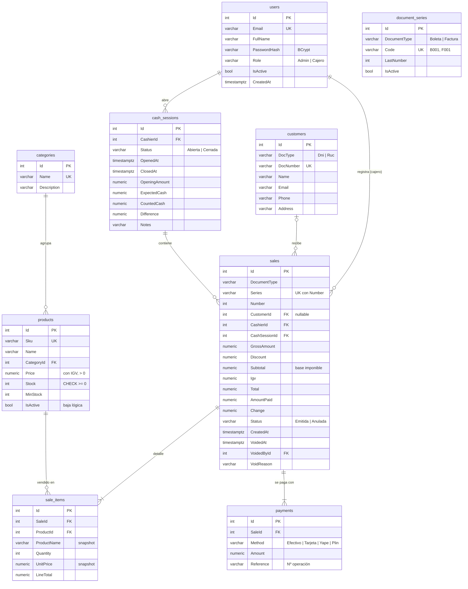

# Modelo de datos

## Tablas

| Tabla | Propósito | Notas de diseño |
|---|---|---|
| `users` | Cuentas del sistema | Correo único en minúsculas; rol guardado como texto legible. |
| `categories` | Agrupación del catálogo | No se puede borrar si tiene productos (FK `Restrict`). |
| `products` | Catálogo e inventario | `Price` incluye IGV. `CHECK (Stock >= 0)` como última barrera. Baja lógica para no romper comprobantes históricos. |
| `customers` | Adquirentes | El número de documento es único e inmutable (se validó con módulo 11 / 8 dígitos). |
| `cash_sessions` | Turnos de caja | Índice `(CashierId, Status)` para encontrar rápido la caja abierta. Los campos del arqueo se llenan al cerrar. |
| `document_series` | Series y último correlativo | La fila se bloquea con `UPDATE` durante la venta: los correlativos son consecutivos y sin duplicados. |
| `sales` | Cabecera del comprobante | Índice único `(Series, Number)`. Los importes se guardan (no se recalculan) porque son un documento tributario emitido. Las ventas anuladas no se borran. |
| `sale_items` | Detalle | Guarda nombre y precio **al momento de la venta** (snapshot). |
| `payments` | Medios de pago | Una venta puede tener varios (pago mixto). El vuelto se guarda en `sales.Change`. |

## Tipos y convenciones

- Montos: `numeric(12,2)` en PostgreSQL (nunca `float`). En SQLite (solo pruebas/local) se mapean a `REAL` porque SQLite no agrega decimales en SQL.
- Fechas: `timestamp with time zone` en UTC. La conversión a hora de Lima ocurre en reportes y en la UI.
- Enums: almacenados como texto (`"Boleta"`, `"Efectivo"`) para que la base sea legible desde cualquier herramienta de BI.
- El esquema completo, generado desde las migraciones, está en [esquema-postgres.sql](esquema-postgres.sql).
